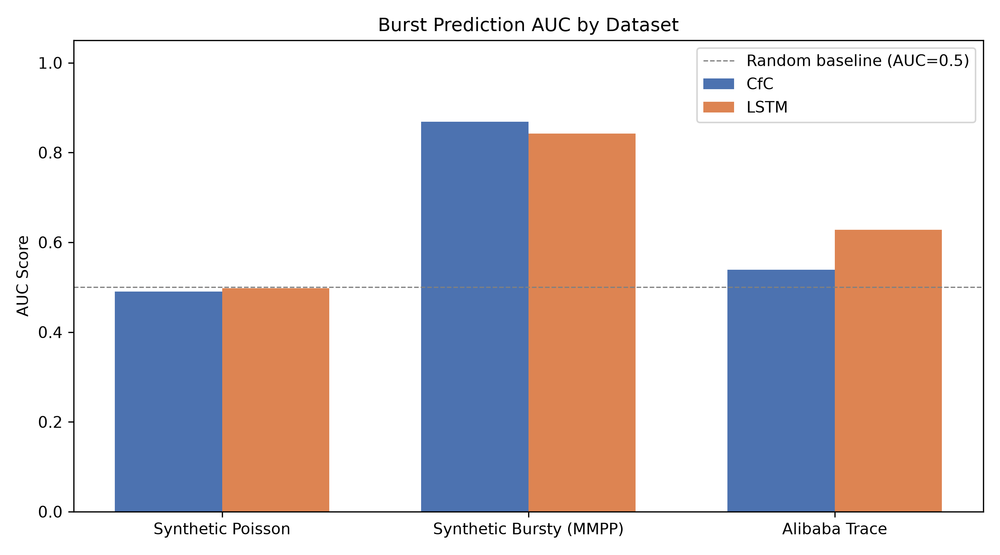
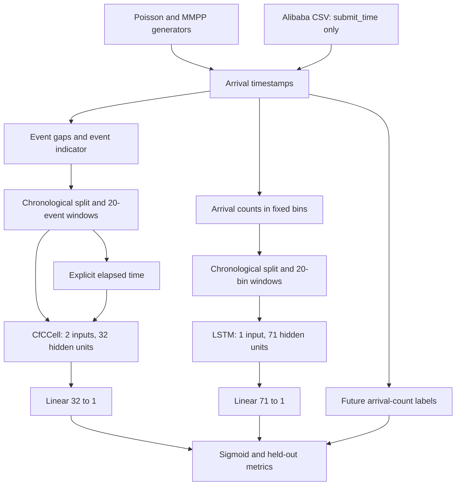

# Liquid Neural Networks for AI-Based CPU Scheduling: An Empirical Study of Burst Prediction

An empirical comparison of Closed-form Continuous-time (CfC) networks and a parameter-matched LSTM for predicting high-arrival workload windows. The experiment uses Poisson and Markov-Modulated Poisson Process (MMPP) workloads and Alibaba PAI submission timestamps.

**Scope:** this is a prediction feasibility study. It does not implement a CPU scheduler or demonstrate reduced waiting time, turnaround time, or improved CPU utilization. CfC has higher observed AUC on synthetic MMPP data; LSTM has higher observed AUC on the Alibaba slice.

## Presentation

[Updated presentation (PDF, 27 slides)](presentations/Liquid_Neural_Networks_CPU_Scheduling_Updated.pdf) includes detailed architecture diagrams, all saved classification results, timing, and diagnostic plots.

## Results

Values below come from [the saved experiment CSV](project/data/results_summary.csv). Accuracy and F1 use probability > 0.5. CPU latency is milliseconds per batch, not per job.

| Dataset | Model | ROC AUC | F1 | Accuracy | CPU ms/batch | Parameters |
| --- | --- | ---: | ---: | ---: | ---: | ---: |
| Poisson | CfC | 0.4903 | 0.0000 | 0.8792 | 2.944 | 21,025 |
| Poisson | LSTM | 0.4976 | 0.0000 | 0.8769 | 0.759 | 21,088 |
| Bursty MMPP | CfC | 0.8684 | 0.9458 | 0.9163 | 2.982 | 21,025 |
| Bursty MMPP | LSTM | 0.8422 | 0.7432 | 0.9291 | 0.878 | 21,088 |
| Alibaba PAI | CfC | 0.5387 | 0.9843 | 0.9691 | 4.432 | 21,025 |
| Alibaba PAI | LSTM | 0.6278 | 0.9667 | 0.9357 | 0.834 | 21,088 |

Poisson ranking is approximately random. Alibaba labels are heavily skewed toward bursts, so high F1 and accuracy do not imply strong discrimination. Different prediction schedules and splits limit direct comparisons. These are single-run results, without statistical significance estimates.



## Architecture



The branches train independently with binary cross-entropy on logits. CfC receives elapsed time both as a feature and through `timespans`; this duplication is an implementation choice. The library's CfC cell performs a direct time-dependent update without numerical ODE integration. See [architecture and methodology](docs/ARCHITECTURE.md) for tensor shapes and exact data handling.

## Repository structure

```text
project/
  main.py                 Main experiments, result CSV, AUC and timing plots
  synthetic_data.py       Poisson and MMPP generators
  data_pipeline.py        Features, labels, chronological splits and loaders
  train.py                Model definitions, training and evaluation
  config.py               Portable dataset path configuration
  generate_figures.py     Additional training, diagnostics and saved weights
  requirements.txt        Dependencies
  data/                   Saved summary and training histories
  figures/                Six diagnostic and comparison plots
  models/                 Six saved state dictionaries
  paper/                  Earlier research draft; see caveat below
presentations/            Updated PDF
docs/                     Architecture, reproduction and interpretation
```

## Setup and execution

Use Python 3.10 or newer and a compatible PyTorch installation. From the repository root:

```powershell
python -m venv .venv
.\.venv\Scripts\Activate.ps1
python -m pip install -r project/requirements.txt
cd project
python main.py
```

On macOS/Linux, activate with `source .venv/bin/activate` before changing into `project`.

The synthetic experiments run without downloading a dataset. When the Alibaba CSV is missing, scripts print a notice and skip that experiment. **A synthetic-only run overwrites the result summary with two datasets.** Preserve the committed outputs if you need the original three-dataset evidence.

For extra diagnostics and model weights:

```powershell
python generate_figures.py
```

This retrains models; it does not just render existing weights. Its training histories, curves and weights come from a separate run, so do not assume they are identical to the run behind `results_summary.csv`.

## Alibaba dataset

The external trace is not redistributed here. Obtain `pai_job_duration_estimate_100K.csv` from the [Alibaba v2020 simulator trace directory](https://github.com/alibaba/clusterdata/tree/master/cluster-trace-gpu-v2020/simulator/traces/pai). Dataset context and attribution are available in the [upstream v2020 documentation](https://github.com/alibaba/clusterdata/tree/master/cluster-trace-gpu-v2020).

Place the file at:

```text
datasets/alibaba_cluster/cluster-trace-gpu-v2020/simulator/traces/pai/pai_job_duration_estimate_100K.csv
```

Or set an absolute CSV path before running either script:

```powershell
$env:ALIBABA_CSV = 'C:\data\pai_job_duration_estimate_100K.csv'
```

On macOS/Linux: `export ALIBABA_CSV=/absolute/path/pai_job_duration_estimate_100K.csv`.

Only `submit_time` supplies model features and labels. CPU/GPU requests, duration and waiting time are unused. The scripts sort by submission time and keep the first 20,000 rows. This is a derived simulator CSV, not the entire original trace. See [reproduction details](docs/REPRODUCIBILITY.md).

## Limitations and document status

- CfC evaluates at events; LSTM evaluates at bin edges. Splits are by event count versus grid count, so temporal boundaries and class balance can differ.
- Twenty events and twenty bins provide different historical coverage.
- Split-local labels avoid using the next split's events, but incomplete future windows near split endings can be mislabeled. A stronger evaluation should discard them.
- The implementation's `EventDataset.__len__` omits the final otherwise-valid sequence.
- Single seed, fixed thresholds, one real-data slice, no uncertainty estimates or simple arrival-rate baseline.
- CfC uses a Python step loop while LSTM uses optimized sequence processing. Measured timing is implementation-dependent.
- Validation metrics are recorded, but the final epoch is evaluated without best-checkpoint selection.

The [paper](project/paper/LNN_Scheduling_Paper.md) is an earlier draft retained for context. Its claims about novelty, causality and scheduler applicability exceed what the experiment establishes. Use this README, methodology documents and the updated presentation for the qualified interpretation. The presentation retains the supplied literature-review slides; this upload does not independently verify all bibliography entries.

## References

- Hasani et al., *Liquid Time-constant Networks*, AAAI 2021.
- Hasani et al., *Closed-form Continuous-time Neural Networks*, Nature Machine Intelligence, 2022.
- Weng et al., *MLaaS in the Wild: Workload Analysis and Scheduling in Large-Scale Heterogeneous GPU Clusters*, NSDI 2022. See the upstream Alibaba dataset documentation for its citation and terms.
- [ncps implementation](https://github.com/mlech26l/ncps) supplies the CfC cell. PyTorch supplies the LSTM.
